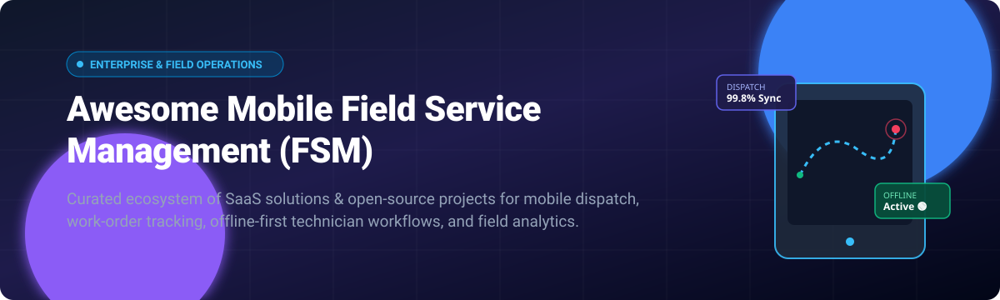

  

  
  
  
  
  
  

---

# 📱 Awesome Mobile Field Service Management (FSM)

> **A curated ecosystem of cutting-edge SaaS platforms and open-source solutions for mobile dispatch, offline field job execution, work-order management, and technician productivity.**

Welcome to the definitive directory for **Mobile Field Service Management (FSM)**. Whether you manage HVAC contractors, utility maintenance crews, electrical service fleets, or telecom field engineers, these tools empower mobile workers with real-time routing, digital job orders, offline data capture, and on-site payments.

---

## 📑 Table of Contents
- [📊 Sector Overview & Market Dynamics](#-sector-overview--market-dynamics)
- [🏢 SaaS & Commercial Platforms](#-saas--commercial-platforms)
- [💻 Open-Source Projects](#-open-source-projects)
- [🧰 Custom FSM Stack Building Blocks](#-custom-fsm-stack-building-blocks)
- [📈 Star History](#-star-history)
- [🤝 How to Contribute](#-how-to-contribute)
- [💖 Support & Sponsorship](#-support--sponsorship)
- [⚠️ Disclaimer](#️-disclaimer)

---

## 📊 Sector Overview & Market Dynamics

The global **Field Service Management (FSM)** market is estimated at **$4.5 billion to $5.2 billion** and is projected to expand to **over $9.8 billion by 2030** (growing at a compound annual growth rate of ~14.5%). The sector exhibits **moderate fragmentation**: while mega-cap enterprise suites (such as Salesforce Field Service, SAP, and ServiceMax) dominate Fortune 500 capital-intensive deployments, a dynamic cohort of vertical specialists (ServiceTitan, Jobber, Housecall Pro) captures immense trade-specific market share. Concurrently, offline-first architectures, low-code inspection toolkits, and modular open-source stacks are rapidly decentralizing custom field operations.

---

## 🏢 SaaS & Commercial Platforms

The following table summarizes industry-leading commercial FSM software, ranked by company size (valuation / annual revenue, descending):

| Product | Company Size (Valuation / Revenue) | Starting Pricing Tier | Free Tier / Trial Limit | Key Focus & Mobile Capabilities |
| :--- | :--- | :--- | :--- | :--- |
| [Salesforce Field Service](https://www.salesforce.com/products/field-service/) | **~$300B Market Cap** (~$35B ARR) | **$50 / user / month** (Field Service Dispatcher / Tech) | **30-day free trial** (full enterprise feature sandbox, no credit card required) | Enterprise FSM integrated into Salesforce CRM, advanced AI schedule optimization, offline mobile app. |
| [ServiceTitan Mobile](https://www.servicetitan.com/) | **~$8B - $9.5B Valuation** (~$650M+ ARR) | **$398 / technician / month** (plus onboarding package) | **No free tier**; interactive guided demo & tailored pilot evaluation on request | Purpose-built for residential & commercial HVAC, plumbing, and electrical trades with visual sales proposals. |
| [Housecall Pro Mobile](https://www.housecallpro.com/) | **~$1.5B Valuation** (~$120M+ ARR) | **$49 / month** (Basic plan, billed annually for 1 user) | **14-day free trial** (unlimited access to core scheduling, dispatch, and mobile app features) | Streamlined mobile platform for small-to-midsize home service pros: instant online booking, GPS dispatch, text alerts. |
| [Jobber App](https://www.getjobber.com/features/field-service-management-app/) | **~$1B+ Valuation** (~$100M+ ARR) | **$39 / month** (Core plan, billed annually for 1 user) | **14-day free trial** (full feature access for up to 10 users, no credit card required) | Mobile-first quoting, CRM, drag-and-drop team scheduling, on-site card reader integration, and client hub. |
| [TrueContext / ProntoForms](https://truecontext.com/) | **~$150M Valuation** (Acquired / ~$30M+ ARR) | **$25 / user / month** (Essentials tier) | **30-day free trial** (up to 5 team mobile licenses with custom mobile form builder and cloud connections) | Offline-capable mobile forms, compliance checklists, AI-guided inspection workflows, and deep ERP integrations. |
| [BigChange](https://www.bigchange.com/) | **~$130M Valuation** (£100M acquisition) | **£14.95 (~$19) / user / month** (JourneyWatch tracking) / **£39.95 (~$51) / user / month** (Full JobWatch) | **14-day free trial** (pilot testing on JobWatch mobile technician software upon request) | All-in-one UK/EU job management system: live vehicle telematics, CRM, scheduling, mobile paperless workflows. |
| [Praxedo Mobile](https://www.praxedo.com/) | **~$80M Valuation** (~$20M ARR) | **$25 / user / month** (Starter edition) | **30-day free trial** (up to 5 field technician mobile logins with web dispatch console) | Highly configurable cloud FSM software with smart scheduling, offline native mobile apps, and work order tracking. |
| [FieldAware](https://www.fieldaware.com/) | **~$40M - $60M Valuation** (GPS Insight) | **$70 / user / month** | **14-day free trial** (includes mobile app testing, dispatch module, and asset history demos) | Robust work order lifecycle management, asset tracking, parts inventory, and bi-directional ERP connectors. |
| [mHelpDesk](https://mhelpdesk.com/) | **~$25M - $35M Valuation** (HomeAdvisor/Angi) | **$169 / month** (includes first 3 users) | **14-day free trial** (hands-on test drive for all office and mobile field capabilities) | Automated field service workflows, QuickBooks desktop & online sync, work order tracking, and mobile invoicing. |

---

## 💻 Open-Source Projects

Self-hosted and developer-friendly solutions for full data sovereignty, zero per-seat licensing fees, and bespoke technician workflows. Sorted by GitHub Stars_Count (descending):

| Repository | GitHub_Stars | Core Stack | Description |
| :--- | :--- | :--- | :--- |
| [odoo/odoo](https://github.com/odoo/odoo) |  | Python, JavaScript | Comprehensive open-source ERP with integrated Field Service module for planning, routing, timesheets, and mobile signatures. |
| [calcom/cal.com](https://github.com/calcom/cal.com) |  | TypeScript, Next.js | Enterprise scheduling infrastructure for dispatch calendars, technician shift booking, and automated appointments. |
| [frappe/erpnext](https://github.com/frappe/erpnext) |  | Python, JavaScript, MariaDB | Full-featured open-source ERP featuring maintenance visit logs, field work orders, technician assignments, and warranties. |
| [chatwoot/chatwoot](https://github.com/chatwoot/chatwoot) |  | Ruby on Rails, Vue | Omnichannel customer and dispatcher communication platform with mobile technician chat and live status notifications. |
| [budibase/budibase](https://github.com/budibase/budibase) |  | Svelte, Node.js | Low-code engine for rapidly constructing custom internal mobile field inspection forms, checklist trackers, and approval flows. |
| [grocy/grocy](https://github.com/grocy/grocy) |  | PHP, SQLite | Self-hosted ERP & task coordinator with barcode scanning, asset maintenance scheduling, and mobile web interface. |
| [ever-co/ever-gauzy](https://github.com/ever-co/ever-gauzy) |  | TypeScript, NestJS, Angular | Open-source enterprise resource and field staff management platform with GPS timesheet tracking and project dispatching. |
| [traccar/traccar](https://github.com/traccar/traccar) |  | Java, React | Modern open-source GPS tracking system supporting live fleet monitoring, vehicle breadcrumb trails, and geofencing. |
| [Dolibarr/dolibarr](https://github.com/Dolibarr/dolibarr) |  | PHP, MariaDB | Open-source ERP/CRM suite with dedicated Interventions module for logging technician site visits, material use, and quotes. |
| [zammad/zammad](https://github.com/zammad/zammad) |  | Ruby on Rails, PostgreSQL | Helpdesk and ticketing system with mobile-friendly technician views, multi-channel triage, and escalation triggers. |
| [lukevella/rallly](https://github.com/lukevella/rallly) |  | TypeScript, Next.js | Collaborative scheduling software for harmonizing technician shift availability and team coordination. |
| [frappe/helpdesk](https://github.com/frappe/helpdesk) |  | Python, Vue | Modern service ticket and field support portal tightly coupled with ERPNext billing and asset inventories. |
| [horilla-opensource/horilla](https://github.com/horilla-opensource/horilla) |  | Python, Django | Open-source HR and workforce operations software with shift planning, field check-ins, and technician attendance. |
| [openboxes/openboxes](https://github.com/openboxes/openboxes) |  | Java, Groovy | Open-source inventory and supply chain software designed for parts depot management, bin replenishment, and lot tracking. |
| [Tanibox/tania](https://github.com/Tanibox/tania) |  | Go, Vue | Open-source farm and land field management software for outdoor maintenance logging, tasks, and resource tracking. |
| [opencrx/opencrx](https://github.com/opencrx/opencrx) |  | Java | Multi-functional CRM with enterprise activity tracking, contract management, and service case records. |
| [Paulo-BatistaFerraz/flexdesk](https://github.com/Paulo-BatistaFerraz/flexdesk) |  | NestJS, React Native | Open-source FSM platform tailored for trade contractors featuring Stripe payments, offline React Native app, and map routing. |
| [SuperDaveOrg/SiteTrackr](https://github.com/SuperDaveOrg/SiteTrackr) |  | Fastify, React | FieldOps ticketing and site maintenance platform for remote facility technicians with offline PWA support. |

---

## 🧰 Custom FSM Stack Building Blocks

Looking to architect your own self-hosted, offline-first field management engine? Here are foundational building blocks:

- 📶 **Offline-First Data Sync Engines**: [RxDB](https://rxdb.info/), [WatermelonDB](https://nozbe.github.io/WatermelonDB/), [PouchDB](https://pouchdb.com/), [Dexie.js](https://dexie.org/)
- 📱 **Cross-Platform Mobile Toolkits**: [React Native](https://reactnative.dev/), [Flutter](https://flutter.dev/), [Capacitor](https://capacitorjs.com/)
- 🗺️ **Geocoding & Turn-by-Turn Routing**: [OpenStreetMap](https://www.openstreetmap.org/), [Leaflet](https://leafletjs.com/), [OSRM (Open Source Routing Machine)](http://project-osrm.org/), [GraphHopper](https://www.graphhopper.com/)
- 💳 **Mobile & Field Payment Gateways**: [Stripe Terminal SDK](https://stripe.com/terminal), [PayPal Zettle](https://www.zettle.com/)

---

## 📈 Star History

---

## 🤝 How to Contribute

Contributions are warmly welcome! Help make this the most comprehensive and up-to-date guide for mobile field service tools:

1. **Fork the repository** 🍴
2. **Create your feature branch**: `git checkout -b feature/new-tool`
3. **Add/update entries**: Ensure entries are placed in the appropriate section with accurate pricing, links, and descriptions.
4. **Commit your changes**: `git commit -m 'feat: add NewTool FSM'`
5. **Push to branch**: `git push origin feature/new-tool`
6. **Open a Pull Request** 🚀

---

## 💖 Support & Sponsorship

Thank you for exploring and using **Awesome Mobile Field Service Management**! If you find this curated directory helpful for your business, research, or development stack, please consider supporting the project:

- ⭐ **Star this repository** to improve discoverability for other field service professionals.
- 🍴 **Fork and share** with your developer and operations community.
- ☕ **Buy a coffee & sponsor**: You can support ongoing maintenance via the [GitHub Sponsor Dashboard](https://github.com/sponsors/ishandutta2007).

---

## ⚠️ Disclaimer

- This list is community-curated for informational and comparative purposes only and does not constitute an explicit commercial endorsement.
- Mobile field applications handle sensitive customer locations and worker telemetry; always verify compliance with regional privacy frameworks (GDPR, CCPA) and labor tracking laws.
